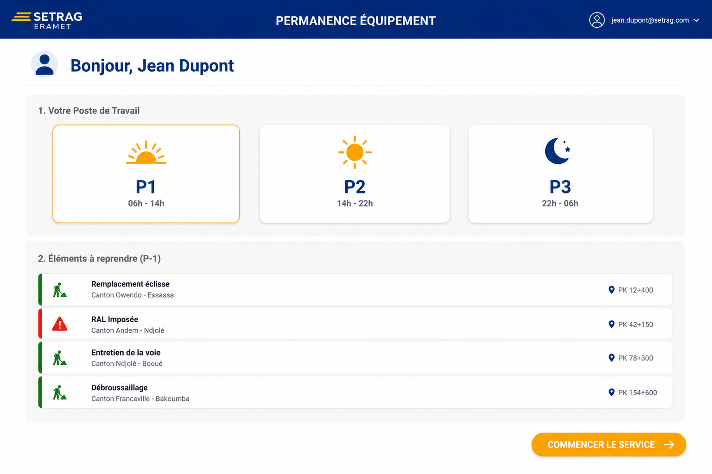

# Écran 1 : Prise de Poste & Relève

## 📋 Présentation Générale
Ce premier écran a pour but d'initialiser la session de travail du permanent **sans saisie manuelle inutile**. Il permet :
- L'auto-identification via le compte Microsoft 365
- La sélection du quart de travail (P1, P2, P3) via des cartes
- La visualisation des éléments à reprendre du poste précédent (chantiers, LTV)

---

## 🎨 Maquette (Référence)

---

## 🖼️ Wireframe / Description des Éléments

### Barre supérieure
- Logo **SETRAG ERAMET**
- Titre **PERMANENCE ÉQUIPEMENT**
- Profil utilisateur (email) avec menu déroulant

### Section de bienvenue
- Icône utilisateur
- Texte : **Bonjour, [Prénom NOM]** (ex: Bonjour, Jean Dupont)

### 1. Votre Poste de Travail
- 3 cartes pour la sélection du quart :
  - **P1** : Icône soleil, texte "06h - 14h"
  - **P2** : Icône soleil, texte "14h - 22h"
  - **P3** : Icône lune, texte "22h - 06h"
- La carte sélectionnée est mise en évidence (bordure orange sur la maquette)

### 2. Éléments à reprendre (P-1)
Liste des éléments en cours du poste précédent, chaque élément comporte :
- Icône (ex: 👷 pour chantier, ⚠️ pour LTV/RAL)
- Titre (ex: Remplacement éclisse, RAL Imposée)
- Canton concerné (ex: Owendo - Essassa, Andem - Ndjolé)
- Icône de localisation + PK (ex: 📍 PK 12+400)
- Indicateur de statut (barre colorée à gauche : verte pour chantier, rouge pour RAL)

### Bouton d'action
- Bouton **COMMENCER LE SERVICE** (orange, flèche vers la droite) en bas à droite

---

## 🗄️ Liaison Frontend (Power Apps) ↔ Backend (SharePoint)

| Élément de l'Écran | Liste SharePoint | Colonne(s) SharePoint | Type de Lien |
|---------------------|------------------|-----------------------|--------------|
| Auto-identification (Nom/Prénom) | Ref_Acteurs | Title | Compte Microsoft 365 → Lookup dans Ref_Acteurs |
| Profil (email) | Ref_Acteurs | - | Compte Microsoft 365 |
| Éléments à reprendre | Tx_Travaux, Tx_LTV | - | Filtre : éléments non clôturés du jour/quart précédent |
| Détails chantier | Tx_Travaux | Title, CantonID | Liaison avec Ref_Cantons pour le nom du canton |
| Détails LTV/RAL | Tx_LTV | Motif_Ralentissement, CantonID | Liaison avec Ref_Cantons |
| PK | Tx_Travaux, Tx_LTV | - | Selon l'élément |

---

## 📝 User Stories Associées

| ID | User Story | Critères d'acceptation |
|----|------------|-------------------------|
| US1.1 | En tant que permanent, je veux que l'application détecte automatiquement mon profil via mon compte M365 afin d'éviter toute saisie manuelle inutile. | - Mon nom/prénom s'affichent automatiquement - Mon email s'affiche en haut à droite - Pas de champ de saisie de mot de passe |
| US1.2 | En tant que permanent, je veux choisir mon quart via des cartes visuelles afin d'initialiser correctement la session. | - 3 cartes (P1/P2/P3) avec icônes - Une seule carte peut être sélectionnée à la fois - La carte sélectionnée est mise en évidence |
| US1.3 | En tant que permanent, je veux voir les éléments à reprendre du poste précédent afin de garantir la continuité du suivi. | - Les éléments non clôturés s'affichent dans la section "Éléments à reprendre (P-1)" - Chaque élément comporte icône, titre, canton et PK - Les statuts sont indiqués via des couleurs |

---

## 🔄 Flux Utilisateur

1. **Ouverture de l'application** : L'écran de prise de poste se charge automatiquement.
2. **Auto-identification** : Récupération du compte Microsoft 365 et affichage du nom/prénom.
3. **Sélection du quart** : Le permanent clique sur la carte correspondant à son quart (P1, P2 ou P3).
4. **Vérification des éléments à reprendre** : Consultation de la liste des éléments en cours.
5. **Validation** : Clic sur "COMMENCER LE SERVICE" → Redirection vers l'écran 2 (Journal de Bord).

